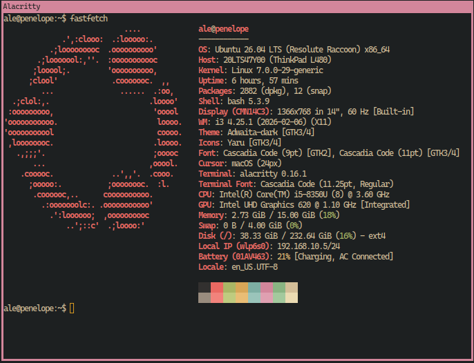

# .bash

My personal **Bash** configuration: two files and the `bash-completion` package.
No framework, nothing third-party sourced into your shell. The prompt stays the
one bash ships with, only always coloured.



## ✨ What you get

- **Stock prompt, always coloured.** The `user@host:path$` bash ships with — one
  line, no git branch, no theme — user@host gruvbox orange, path gruvbox aqua.
  Stock `~/.bashrc` colours it only for `TERM` `xterm-color|*-256color`, which is
  why tmux had colour and alacritty did not; here the test is `tput colors`. On a
  terminal without 256 colours it falls back to plain red and cyan.
- **↑/↓ searches history by prefix.** Type the start of a command, then ↑ walks
  only the entries that begin with it (readline's `history-search-backward`).
- **Tab completion** for git, apt, docker and the rest, via `bash-completion` —
  case-insensitive, and one Tab shows the list instead of two.
- **50 000 lines of history** that appends instead of truncating, drops repeats,
  and skips any command you type with a leading space.
- **Recursive globs and a forgiving `cd`.** `shopt -s globstar`, plus `cdspell`
  and `dirspell` to fix small typos in a directory name.
- **No aliases of its own.** The short ones (`lz`, `ta`, `r`, `calc`, …) live in
  [best-linux-environment](https://github.com/Spuppateddu/best-linux-environment)'s
  `aliases` file, shared by bash and zsh: add a new alias there, not here.
- **`nvm` loaded on first use**, not at every shell start. Sourcing `nvm.sh`
  costs 100–400 ms and most shells never run node.
- **Private lines stay private.** `bash-alias.local` is gitignored and sourced
  automatically. Machine-local aliases go in best-linux-environment's `aliases.local`.
- **The machine turns itself off when nobody is using it** — but that is not
  part of this repo. It is a systemd timer, not a shell setting, so it lives in
  [best-linux-environment](https://github.com/Spuppateddu/best-linux-environment)
  and gets installed whichever shell you picked. See its README, § Idle poweroff.

## 🚀 Install

Two ways in. Same script, same result — this repo does not care which one ran it.

### On its own

```sh
git clone https://github.com/Spuppateddu/configuration-bash.git ~/.bash
~/.bash/install.sh
exec bash
```

That is the whole thing. `install.sh` owns every step — the packages, `~/.bashrc`
and the login shell — so nothing outside this repo is needed.

`~/.bash` is the conventional spot, but any path works: the installer wires
`~/.bashrc` to wherever you cloned it, and `bashrc` finds its own directory at
runtime from `${BASH_SOURCE[0]}`.

Aliases are not in this repo: best-linux-environment's `aliases` (every machine)
and `aliases.local` (this machine, gitignored) hold them all.

### As part of best-linux-environment

[**best-linux-environment**](https://github.com/Spuppateddu/best-linux-environment)
sets up a whole Ubuntu box. It clones this repo into `~/linux-configuration/bash`,
symlinks `~/.bash` to it, and calls this same `install.sh` — then keeps it pulled
and re-applied at every boot. The `b-reload` alias triggers that by hand.

Several shell configs can live on one machine, but only one owns the login shell.
That is what `--no-login-shell` is for: best-linux-environment passes it to the
configs that did *not* win, so re-running `boot.sh` never quietly `chsh`-es you
back.

## 📦 Requirements

Only bash is required. Everything else is optional — you lose the matching alias
(from best-linux-environment's `aliases`) and nothing else.

| Tool | Needed for |
| --- | --- |
| [Bash](https://www.gnu.org/software/bash/) 4.2+ | The shell itself. `${var/#pat/rep}` and `local -a` need it; Ubuntu ships 5.x |
| [bash-completion](https://github.com/scop/bash-completion) | Tab completion for git, apt, docker… |
| [tmux](https://github.com/tmux/tmux) | `ta`, `tn` |
| [yazi](https://github.com/sxyazi/yazi) | `r` |
| [lazygit](https://github.com/jesseduffield/lazygit) / [lazydocker](https://github.com/jesseduffield/lazydocker) | `lz`, `ld` |
| [Qalculate](https://qalculate.github.io/) | `calc` (provides `qalc`) |

`install.sh` installs bash, git, curl and bash-completion for you — this list is
only for wiring things up by hand.

## 🔧 Usage

| Alias | Does |
| --- | --- |
| `lz` / `ld` | Open `lazygit` / `lazydocker` |
| `home` | `cd` to your home folder (`$HOME`, so the same on every PC) |
| `v` | `vim .` |
| `r` | Open `yazi`, and `cd` to wherever you left it |
| `ta` | `tmux attach` |
| `tn [name]` | New tmux session, named if you give it one |
| `calc ['43 + 5 * 20']` | Qalculate, interactive or one-shot |
| `b-reload` | Re-apply every config repo via best-linux-environment's `boot.sh`, then `exec bash` |

They come from best-linux-environment's `aliases` file. Installer flags:

| Flag | Does |
| --- | --- |
| `--dry-run` | Print every step, change nothing. `DRY_RUN` in the environment works too |
| `--no-login-shell` | Wire the config, but don't `chsh` — for when another shell owns the login shell |

## 🔍 What the installer actually does

It is idempotent, so re-run it any time to update.

1. Installs bash, git, curl and bash-completion (apt, or Homebrew on macOS).
2. Backs up `~/.bashrc`, then **appends** `source <repo>/bashrc` to the **end**
   of it.
3. Sets bash as your login shell.

Appending at the end is the whole trick. Ubuntu's stock `~/.bashrc` sets its own
history options and aliases; going last is what makes this config win over them
instead of being overwritten by them. Nothing in the stock file is deleted, and
its `PS1` block still runs — this config just repaints the prompt after it.

Run it as yourself, **not** with `sudo`: it configures `$HOME`, and under `sudo`
that is root's. It escalates on its own for the package installs, and refuses to
run rather than quietly setting up root's shell instead of yours.

If you keep a hand-written `~/.bash_profile`, the installer checks it. Bash reads
*that* file at login and ignores `~/.profile` (the one Ubuntu ships, which
sources `~/.bashrc`) — so a TTY or ssh session would get none of this config. It
prints the one line to add rather than editing your file.

## 🩺 The login shell changed, but my terminal didn't

This looks like a bug and isn't.

`chsh` writes `/etc/passwd` — and almost nothing reads `/etc/passwd`. What
terminals read is `$SHELL`, which PAM sets **once**, when your desktop session
logs in, from whatever `/etc/passwd` said at that moment. Change it afterwards
and the running session never hears about it: your window manager still holds the
old value, and every terminal it spawns inherits it.

Measured on Alacritty 0.16 — it prefers `$SHELL`, and only falls back to the
passwd entry when `$SHELL` is unset:

```
SHELL unset             -> bash          (falls back to the passwd entry)
SHELL=/usr/bin/bash     -> bash
SHELL=<any other shell> -> that shell    (passwd said bash — $SHELL won)
```

So a brand-new window from the same session is still the old shell. Fixes, least
to most thorough:

| | |
| --- | --- |
| this shell, right now | `exec bash -l` |
| new tmux panes | `tmux kill-server` (a running server cached the old `$SHELL`) |
| everything, properly | log out and back in |

One more wrinkle: `chsh` asks PAM for your password, so it needs either a
terminal to ask on, or root. Run the script yourself and it asks. Run it from
best-linux-environment and there is no terminal (stdin is `/dev/null`, so no
installer can stop the run to ask), so it uses that run's already-cached `sudo`.
If neither is available it says so and prints `chsh -s /usr/bin/bash` for you —
it never reports success for something it skipped.

## 📁 Layout

```
.bash/
├── install.sh    # installs deps + wires ~/.bashrc (idempotent)
├── bashrc        # main entry point (sourced from the end of ~/.bashrc)
├── bash-alias    # aliases & functions (sources bash-alias.local)
└── pictures/     # screenshots used by this README
# bash-alias.local — your private, untracked aliases (gitignored)
```

## 📄 License

Personal dotfiles — feel free to copy anything useful.
